# Basemap project

Builds the map tiles for Scotland used at <https://www.daniel-williams.co.uk/map/>.

The cartography lives in a QGIS project (`projects/basemap.qgz`, with layer styles
exported to `styling/`). This repository prepares the data the project needs and
renders it to XYZ PNG tiles with headless QGIS, so the tiles can be regenerated
without opening QGIS.

Each build goes in a version directory (`<version>` below): `dev` by default, or
the release tag for release builds (`make TILE_VERSION=v1.2 ...`).

Each layer is a separate set of transparent tiles (apart from the topology, which is opaque),
so a map can switch them on and off. A good stacking order, bottom to top, is topology, forests, mist, roads,
paths, rivers, loch names, railways, shelters, facilities, hills, trig points. The zoom a feature
first appears at is described under each layer's section further down.

| Layer | Sample |
|---|---|
| **Topology** (`topology`)<br><br>Terrain, drawn as hypsometric tints with soft hillshade, 50 m contours and water (forest is its own layer, below). Below 200 m the tints run from pale green to beige so hills show in flat country; above that they step through tan to brown. Zoom 9–13. Data: SRTM-derived DEM, OpenStreetMap. | 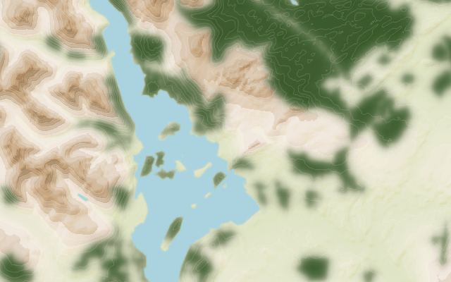 |
| **Forests** (`forests`)<br><br>Woodland as dark green blurred patches, in a transparent overlay so it can be switched off. Blend it with `mix-blend-mode: multiply` (the preview page does) so the hillshade and contours still show through the trees. Zoom 9–13. Data: OpenStreetMap, via the project's `OSM - Forestry` layer. | 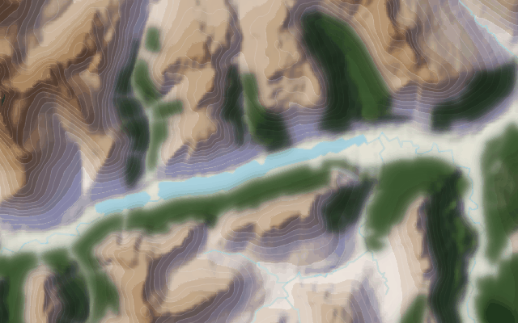 |
| **Valley mist** (`mist`)<br><br>A pale blue haze that collects on valley floors in rugged country and thins up the slopes, after Eduard Imhof's aerial perspective: valleys recede and the summits stand out. Strongest zoomed out and fading as you zoom in (gone by zoom 13). Data: derived from the DEM. | 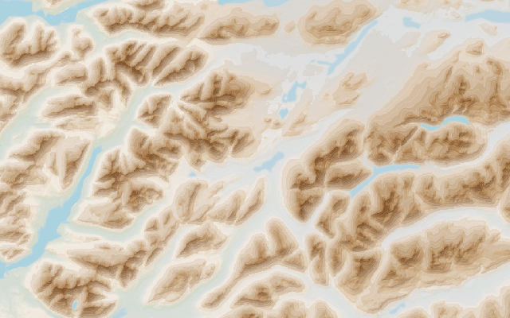 |
| **Hills** (`dbobih`)<br><br>Hill markers with names and heights from the Database of British and Irish Hills, as a transparent overlay. Zoom 9–13. Data: DoBIH. | 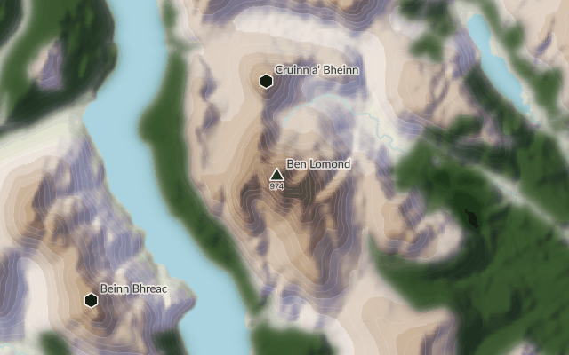 |
| **Trig points** (`trigs`)<br><br>Ordnance Survey triangulation pillars, as a transparent overlay. Zoom 9–13. Data: `sources/trigs.csv`. | 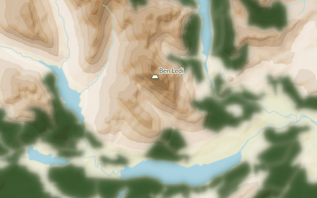 |
| **Roads** (`roads`)<br><br>A deliberately quiet layer of thin grey lines. Zoomed out only motorways, trunk and primary roads show; smaller roads join as you zoom in, down to residential streets at zoom 13. Data: OpenStreetMap. | 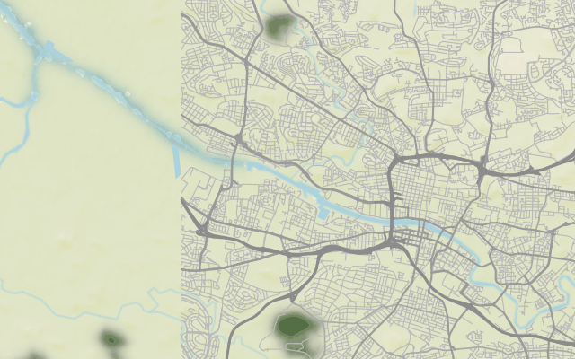 |
| **Railways and stations** (`transport`)<br><br>Every railway as one solid dark grey line, with stations as dark circles and their names. Sidings and yards are left out. Draw it above the roads. Data: OpenStreetMap. | 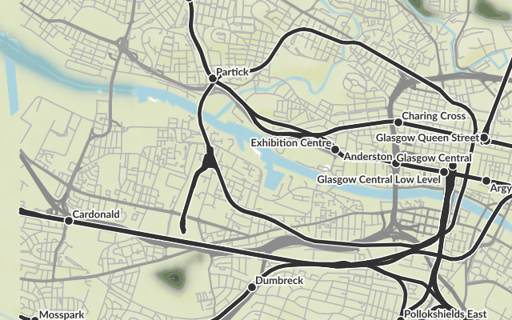 |
| **Paths** (`paths`)<br><br>Footpaths, bridleways and tracks from zoom 12, as light, thin lines: white dashes for paths and light grey lines for tracks. Dash pattern shows `sac_scale` difficulty and faint trails. Data: OpenStreetMap. | 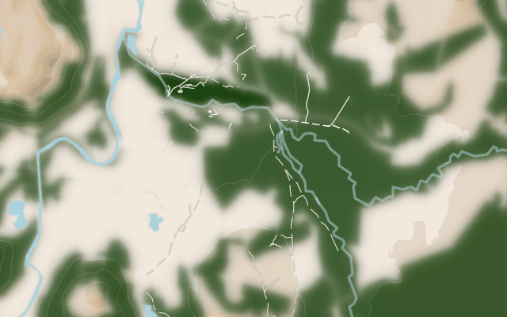 |
| **Rivers and waterfalls** (`rivers`)<br><br>Rivers, streams and canals in the same pale blue as the base map's water, with named rivers and burns labelled along the line, and waterfalls as blue triangles. Data: OpenStreetMap. | 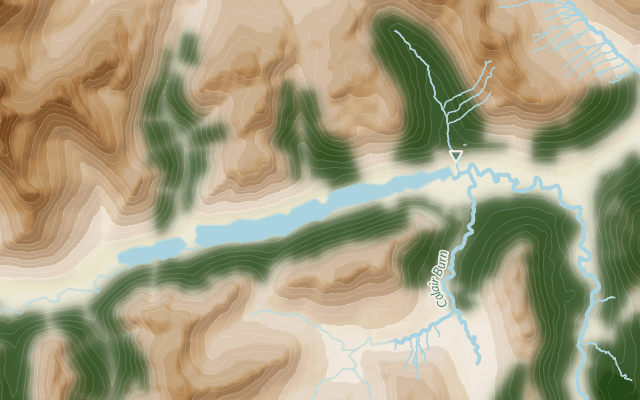 |
| **Loch names** (`waternames`)<br><br>The name of each loch and reservoir, curved along its main axis. Unlike the other layers this is vector data (GeoJSON) drawn in the browser by `preview/water-names.js`, so the text is sharp and uses the page's fonts. Data: OpenStreetMap. | 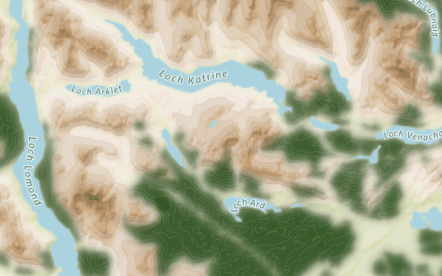 |
| **Bothies and shelters** (`shelters`)<br><br>Bothies as solid blue discs, visible at every zoom, and shelters as smaller hollow discs from zoom 12, with names. Data: OpenStreetMap. | 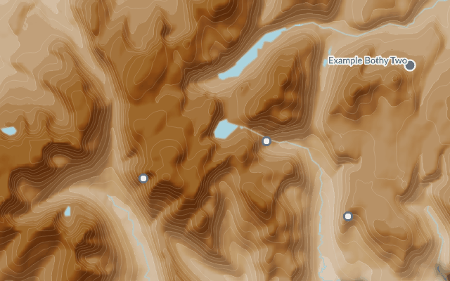 |
| **Trailheads and facilities** (`facilities`)<br><br>Car parks, campsites, hostels, visitor centres, viewpoints, mountain rescue posts, toilets and ferry terminals as small coloured symbols, plus ferry routes. Data: OpenStreetMap. | 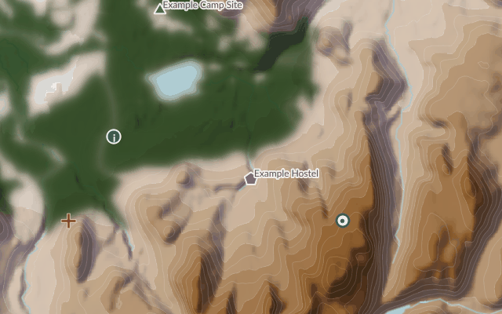 |

The samples were made with `make samples` (the loch names sample is a screenshot of
`preview/index.html`). The railway, road, path, river, loch name, shelter and facility samples were
made while developing the layers with stand-in data (OpenStreetMap-derived tiles and a few example
points) rather than a full OSM extract, so replace them with `make samples` once the real data
has been built.

Tiles are written to `data/tiles/<layer>/<version>/{z}/{x}/{y}.png` (the loch names are
`data/tiles/waternames/<version>/water-names.geojson`).

## Data sources

- **Elevation**: [ViewfinderPanoramas](http://viewfinderpanoramas.org/dem3.html) DEM
  (SRTM-derived), downloaded as 4° × 6° block zips (`N29 N30 O29 O30` cover Scotland).
- **Water and forest**: OpenStreetMap, read by QGIS from the ArcGIS OSM vector tile
  service referenced in the project, so rendering needs internet access.
- **Hills**: `sources/dobih.csv`, the [Database of British and Irish Hills](https://www.hills-database.co.uk).
- **Trig points**: `sources/trigs.csv`.
- **Railways and stations**: `railway=*` ways and `railway=station|halt` nodes from the same
  Geofabrik extract (`make data/transport.gpkg`).
- **Water names**: the named water polygons in the OpenStreetMap
  [Geofabrik extract for Scotland](https://download.geofabrik.de/europe/united-kingdom/scotland.html)
  (about 300 MB, downloaded to `data/scotland.osm.pbf`).

## Prerequisites

- GNU Make, `curl`, `unzip`
- Fonts: Lato (hill and trig names) and Inter (heights and other labels), e.g.
  `fonts-lato fonts-inter` on Ubuntu
- GDAL command-line tools (`gdalbuildvrt`, `gdal_translate`, `gdaldem`, `gdal_contour`)
- Python with `shapely`, `scipy`, `numpy` and the GDAL bindings, for the water name lines
  (`python3-shapely python3-scipy python3-numpy python3-gdal` on Ubuntu)
- QGIS **3.40 or newer** with its Python bindings. The project was saved with QGIS 3.38,
  and the older QGIS 3.34 in Ubuntu 24.04 renders rasters blocky, so on Ubuntu use the
  [QGIS LTR repository](https://qgis.org/resources/installation-guide/#debianubuntu).
  Run `make` with a Python that can `import qgis`, which is the system Python on
  Debian/Ubuntu (`make QGIS_PYTHON=/usr/bin/python3 ...`).

## Usage

```bash
make sample          # Ben Ledi area, zooms 9-12, all three tile sets (~2 minutes)
make dem             # only the DEM, hillshade and contours
make topology        # one tile set for all of Scotland (zooms 9-13)
make tiles           # all three tile sets (slow; see below)
```

Useful variables (all have defaults in the Makefile):

```bash
make topology TILE_BBOX=-5,56,-4,57 TILE_ZMIN=9 TILE_ZMAX=12   # west,south,east,north
make dem HILLSHADE_Z=3 CONTOUR_INTERVAL=25
make sample QGIS_PYTHON=/usr/bin/python3
```

To look at the result, serve the tiles and point Leaflet at them:

```bash
python3 -m http.server -d data/tiles 8000
# L.tileLayer('http://localhost:8000/topology/<version>/{z}/{x}/{y}.png')
```

### How long does it take?

The topology tiles are slow to render, because QGIS fetches the OSM vector tiles
and renders every tile. Scotland at zoom 13 is roughly 40,000 tiles per tile set, so
a full build is a many-hour job. The release workflow builds each tile set in its own
job to stay inside GitHub's per-job limit.

## Water names

The names of lochs are placed along each loch's main axis, and unlike the other layers they
are vector data: the browser draws the text, so it uses the site's own fonts and stays sharp.

`scripts/water_centerlines.py` takes the named OSM water polygons and, for each one, finds
the longest path through its medial axis, so the line follows a winding loch rather than
cutting across it. It smooths the line (written to `data/water-names.gpkg`), and
`make waternames` converts the lines to a small GeoJSON file (`name`, `length_m`).

`preview/water-names.js` is a Leaflet layer that draws them with
[Leaflet.TextPath](https://github.com/makinacorpus/Leaflet.TextPath): size and letter
spacing grow with the loch's length, small lochs only appear at higher zooms, and names
that do not fit along their loch are dropped. Use it from your own map with:

```js
import { WaterNames } from './water-names.js';
new WaterNames('https://tiles.daniel-williams.co.uk/waternames/<version>/water-names.geojson').addTo(map);
```

`preview/index.html` shows all the layers together: run `python3 -m http.server` in the
repository root and open <http://localhost:8000/preview/> (add `?v=<version>` to see another
build).

Lochs that are arms of the sea (Loch Fyne, Loch Linnhe and so on) have no water polygon in
OSM, so they are not labelled by this layer.

## Transport

The `transport` tile set is a prototype of the transport network, with railways and stations
drawn to stand out against the terrain. It is rendered by QGIS from `data/transport.gpkg`
(layers `rail_lines` and `rail_stations`, extracted from the OSM file by `make`). Like the
water names it is not in `basemap.qgz`: `scripts/render_tiles.py` loads the layers and styles
them with `styling/Rail Lines.qml` and `styling/Rail Stations.qml`.

- Every railway is drawn as one solid dark grey line with a thin white edge so it reads over
  forest. The style deliberately drops detail: no tunnels, bridges or railway types, and
  sidings, yards and spurs (anything with `service=*`) are left out, which hides the number of
  tracks.
- Stations are dark circles with a white outline, sized by zoom, with bold Lato names; halts
  are slightly smaller and appear from zoom 11.

### Roads

The `roads` tile set is a deliberately quiet companion to the railways: thin mid-grey lines with
no casing or labels, drawn from `data/roads.gpkg` (`make data/roads.gpkg`) with
`styling/Roads.qml`. Only main roads are included (motorway down to residential), not tracks,
paths or service roads. Bigger roads are slightly darker and heavier and draw on top. Add it
beneath the `transport` layer so the railways stay on top.

Zoomed out (zoom 9 and 10) only motorways, trunk roads and primary roads are shown. Secondary
roads join at zoom 11, tertiary and unclassified roads at zoom 12 and residential streets at
zoom 13.

## Paths

The `paths` tile set (`make data/paths.gpkg`, styled by `styling/Paths.qml`) shows `highway=path`,
`footway`, `bridleway` and `track` from zoom 12. Pavements and crossings (`footway=sidewalk` or
`crossing`), ways closed to walkers (`foot=no`) and private ways are left out.

The lines are deliberately light and thin: each has a faint dark edge so it still reads on pale
ground, but the line itself is white or light grey, so it stands out on forest and dark hillshade
without dominating the map.

- **Tracks** are solid light grey lines; better surfaced ones (`tracktype` grade 1 and 2) are slightly
  heavier, rougher ones are dashed.
- **Footpaths and bridleways** are white dashes. Difficulty only changes the dash pattern, following
  `sac_scale`: `mountain_hiking` has longer dashes, demanding or alpine paths are dots, and paths
  whose `trail_visibility` is bad or worse are sparse dots.

Where `sac_scale` or `trail_visibility` are not mapped (common in Scotland) a path is drawn as an
ordinary footpath. Draw it beneath the railways and above the roads.

## Rivers and waterfalls

The `rivers` tile set (`make data/rivers.gpkg`, styled by `styling/Rivers.qml` and
`styling/Waterfalls.qml`) draws `waterway=river`, `stream` and `canal` as lines in the same pale blue as the base map's water (`#aad3df`), leaving out
underground culverts and ditches. Rivers show from zoom 9 and streams from zoom 12. Named rivers and canals are labelled along the line in italic Lato from zoom 11, and
named streams (burns) from zoom 13.

Waterfalls (`waterway=waterfall` points) are small blue downward triangles from zoom 12, with
their names from zoom 13.

The topology tiles already draw some water lines from the ESRI OSM service, so this layer
overlays slightly heavier lines on top of them. Labels and the waterfall markers use a darker
blue so they stay legible.

## Trailheads and facilities

The `facilities` tile set (`make data/facilities.gpkg`, styled by `styling/Facilities.qml` and
`styling/Ferries.qml`) marks the places walkers start from and stay at. Areas such as car parks are
reduced to a point inside them. Zoom is the first zoom each kind is shown at:

| Symbol | What | Zoom | Name shown from |
|---|---|---|---|
| blue square with a white P | car parks (not multi-storey, underground, street or private) | 13 | not labelled |
| green triangle | campsites (`tourism=camp_site`) | 12 | 12 |
| purple pentagon | hostels (`tourism=hostel`) | 11 | 12 |
| blue disc with an i | visitor centres | 12 | 13 |
| white ring with a blue centre | viewpoints | 12 | 13 |
| red cross | mountain rescue posts | 12 | 13 |
| grey dot | toilets | 13 | not labelled |
| dark blue square with an F | ferry terminals | 10 | 11 |

Ferry routes (`route=ferry`) are dashed dark blue lines, labelled along the line from zoom 11.
The extraction uses `scripts/osmconf.ini`, which has the extra OSM tags as columns.

Bus stops are not included yet.

## Bothies and shelters

The `shelters` tile set (`make data/shelters.gpkg`, styled by `styling/Shelters.qml`) marks
bothies and shelters from OSM:

- **Bothies**: `tourism=wilderness_hut` or `bothy=yes`. Solid blue discs (the blue the QGIS
  project already uses for bothies) with a white edge, shown at every zoom, with names from
  zoom 11.
- **Shelters**: `amenity=shelter`, leaving out bus stop and picnic shelters (those with
  `shelter_type=public_transport` or `picnic_shelter`, or tagged `bus`/`public_transport`).
  Smaller hollow discs from zoom 12, with italic names from zoom 13.

Mapped buildings are reduced to a point inside them. The extraction uses
`scripts/osmconf.ini`, GDAL's default OSM configuration with the bothy and shelter tags
added as columns.

## Editing the styling

Layer styles are stored as `.qml` files in `styling/` so they can be diffed.

```bash
make export-styles          # project -> styling/
make apply-styles           # styling/ -> project
```

Hill and trig point names are drawn in Lato rather than the font stored in the project;
change it with `--name-font` (`''` keeps the project's font).

`scripts/render_tiles.py` chooses which project layers each tile set draws, and in
what order (it draws the contours above the forest, which the project itself does not).

## GitHub Actions

`.github/workflows/build-tiles.yml` builds on:

- **Push to main**: sample tiles for each tile set (the small `SAMPLE_BBOX` area, zooms 9-12).
- **Release**: full tile sets. The release tag is the version in the tile URLs
  (`{tileset}/{tag}/{z}/{x}/{y}.png`).
- **Manual run**: sample only (version `sample`). Full builds only happen on a release.

The build runs in stages so that rendering, the slow part, is spread over many jobs:

1. **plan** works out the version, the area and the list of jobs.
2. **data** builds the data files once: the DEM, hillshade and contours, the OSM extracts for the
   roads, railways, paths, rivers, shelters and facilities, and the loch names (which are vector
   data, so they are finished here). It shares them with the next stage as an artifact.
3. **tiles** renders every tile set for one *shard* per job, using `make render-<tileset>`.
4. **release** (releases only) attaches all the shards to the release.

A full build is cut into 2 columns × 4 rows of shards, so 9 tile sets × 8 shards = 72 render jobs
that run in parallel. Change the grid with the repository variables `SHARD_COLS` and
`SHARD_ROWS` (Settings → Secrets and variables → Actions → Variables); more shards means shorter
jobs but more overhead, as each job installs QGIS. Shards follow zoom 9 tile edges
(`scripts/shards.py`), so the tiles of every zoom fall in exactly one shard and nothing overlaps.

Each shard becomes a release asset called `<tileset>-<tag>-<shard>.tar.gz`, and the loch names are
`waternames-<tag>.tar.gz`. Every archive holds `<tileset>/<tag>/...`, so unpack them all into the
same directory to get the tile tree. Splitting the assets this way also keeps each under GitHub's
2 GB limit per file.

## Lowland colours

The DEM colour ramp (`styling/merged-dem.qml`) originally gave everything below 100 m one
almost white colour, so hills disappeared in flat country such as Glasgow. `scripts/lowland_ramp.py`
rewrites the levels below 200 m as 15 bands (every 10 m to 100 m, then every 20 m) running from a
pale sage green at sea level to the beige of the old 100-200 m band. Levels from 200 m up are
unchanged, so mountains look as before. Change `LOW`, `HIGH` or `BREAKS` in the script and run
`python3 scripts/lowland_ramp.py` to adjust it.

`scripts/render_tiles.py` applies this QML to the topology tiles. `projects/basemap.qgz` still has
the old ramp, so load `styling/merged-dem.qml` onto the `merged-dem` layer in QGIS (or run
`make apply-styles` and save) to see the same colours there.

## Coastlines

The project's sea comes from the ESRI OSM service as a coarse polygon that its style blurs, which
made coastlines soft (and hid how generalised they are). The topology tiles draw a sharper sea
instead: `scripts/make_sea.py` (`make data/sea.gpkg`) takes the part of the DEM at or below sea
level (the DEM is 0 over the sea), contours its edge at 0.5 m so the coast follows the shoreline
to a fraction of a pixel, and lightly smooths it. `styling/Sea.qml` fills it with the project's sea
colour, and `scripts/render_tiles.py` switches off the project's own sea and beach polygons. Lakes
and the forest keep their soft edges. The coast is as accurate as the 3 arc second DEM, about 90 m.

## Valley mist

`make data/mist.tif` (`scripts/make_mist.py`) turns the DEM into a mist density map, which
`styling/Valley Mist.qml` colours as a pale blue-grey haze with the density as its opacity. The
density follows Eduard Imhof's aerial perspective, where valleys are drawn hazier and cooler than
the ridges above them:

- it is highest on the valley floor, found as the lowest ground within 3 km, and fades to nothing
  220 m above it, so a high glen fills with mist as well as a low one;
- it thins with altitude and is gone above about 800 m;
- it only forms in rugged country (local relief over a few hundred metres), so a lowland plain
  does not get a blanket of haze.

The constants at the top of the script control this; the colour and strength are in the QML. The
tile set is faded with zoom (`opacity_by_zoom` in `scripts/render_tiles.py`) so that it hazes the
overview but not close-up detail. Put it above the topology and forests and below everything else.

## Notes

- `HILLSHADE_Z` (vertical exaggeration) was tuned by eye against the live tiles. If
  the shading differs from the site, adjust it and rebuild with `make dem`.
- The DEM covers 54°N to 60°N. Shetland north of 60°N is not included.
