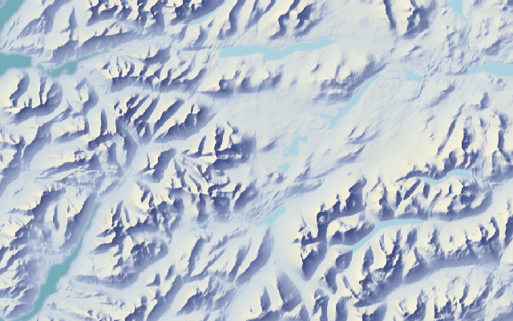
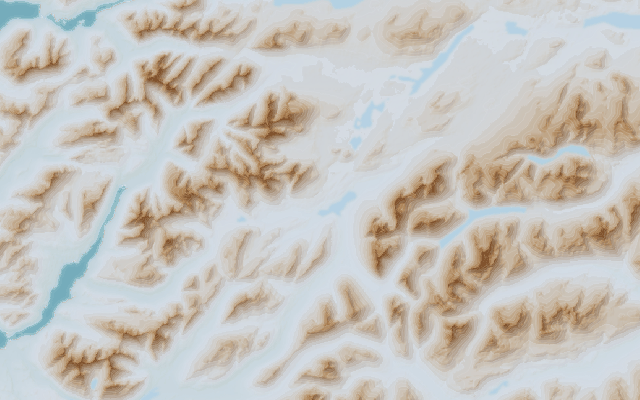
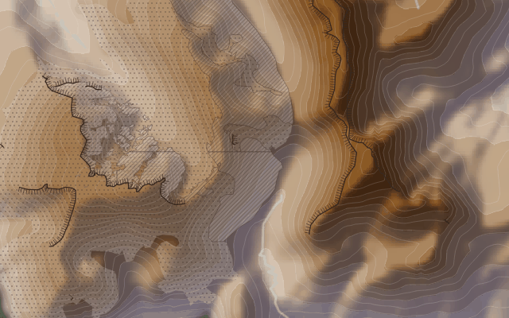
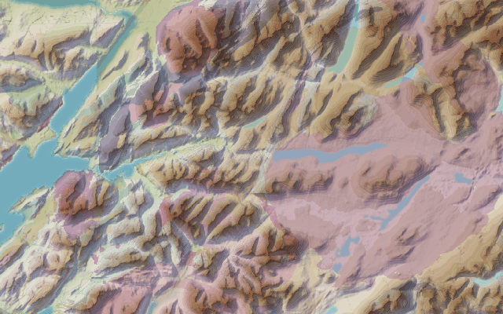

# The Mapa Scotlan

Builds the map tiles for Scotland used at <https://www.daniel-williams.co.uk/map/>.

The cartography lives in a QGIS project (`projects/basemap.qgz`, with layer styles
exported to `styling/`). This repository prepares the data the project needs and
renders it to XYZ PNG tiles with headless QGIS, so the tiles can be regenerated
without opening QGIS.

Each build goes in a version directory (`<version>` below): `dev` by default, or
the release tag for release builds (`make TILE_VERSION=v1.2 ...`).

Each layer is a separate set of transparent tiles (apart from the topology, which is opaque),
so a map can switch them on and off. A good stacking order, bottom to top, is topology (or the Imhof style), forests, mist, roads,
paths, rivers, loch names, railways, shelters, facilities, crags, geology, hills, trig points. The zoom a feature
first appears at is described under each layer's section further down.

| Layer | Sample |
|---|---|
| **Topology** (`topology`)<br><br>Terrain, drawn as hypsometric tints with soft hillshade tinted blue-violet in the shadows (as in the Imhof style, but lighter), 50 m contours and water (forest is its own layer, below). Below 200 m the tints run from pale green to beige so hills show in flat country; above that they step through tan to brown. Zoom 9–13. Data: SRTM-derived DEM, OpenStreetMap. |  |
| **Imhof style** (`imhof`)<br><br>A second basemap, used instead of the topology: no hypsometric tints, but the relief shaded in colour as Eduard Imhof did, warm cream where the light falls and cool blue-violet in shadow, with the valleys veiled in mist that rises to 914 m. Opaque. Zoom 9–13. Data: derived from the DEM. |  |
| **Forests** (`forests`)<br><br>Woodland as dark green blurred patches, in a transparent overlay so it can be switched off. Blend it with `mix-blend-mode: multiply` (the preview page does) so the hillshade and contours still show through the trees. Zoom 9–13. Data: OpenStreetMap, via the project's `OSM - Forestry` layer. |  |
| **Valley mist** (`mist`)<br><br>A pale blue haze that collects on valley floors in rugged country and thins up the slopes, after Eduard Imhof's aerial perspective: valleys recede and the summits stand out. Strongest zoomed out and fading as you zoom in (gone by zoom 13). Data: derived from the DEM. |  |
| **Elevation mist** (`elevmist`)<br><br>A pale blue mist that is thickest at sea level and thins steadily to nothing at 914 m (3,000 ft), as a transparent overlay for the topology tiles (the Imhof style already has it). It fades as you zoom in. Data: the DEM. |  |
| **Hills** (`dbobih`)<br><br>Hill markers with names and heights from the Database of British and Irish Hills, as a transparent overlay. Zoom 9–13. Data: DoBIH. |  |
| **Trig points** (`trigs`)<br><br>Ordnance Survey triangulation pillars, as a transparent overlay. Zoom 9–13. Data: `sources/trigs.csv`. |  |
| **Roads** (`roads`)<br><br>A deliberately quiet layer of thin grey lines. Zoomed out only motorways, trunk and primary roads show; smaller roads join as you zoom in, down to residential streets at zoom 13. Data: OpenStreetMap. |  |
| **Railways and stations** (`transport`)<br><br>Every railway as one solid dark grey line, with stations as dark circles and their names. Sidings and yards are left out. Draw it above the roads. Data: OpenStreetMap. |  |
| **Paths** (`paths`)<br><br>Footpaths, bridleways and tracks from zoom 12, as light, thin lines: white dashes for paths and light grey lines for tracks. Dash pattern shows `sac_scale` difficulty and faint trails. Data: OpenStreetMap. |  |
| **Rivers and waterfalls** (`rivers`)<br><br>Rivers, streams and canals in the same pale blue as the base map's water, with named rivers and burns labelled along the line, and waterfalls as blue triangles. Data: OpenStreetMap. |  |
| **Loch names** (`waternames`)<br><br>The name of each loch and reservoir, curved along its main axis. Unlike the other layers this is vector data (GeoJSON) drawn in the browser by `preview/water-names.js`, so the text is sharp and uses the page's fonts. Data: OpenStreetMap. |  |
| **Bothies and shelters** (`shelters`)<br><br>Bothies as solid blue discs, visible at every zoom, and shelters as smaller hollow discs from zoom 12, with names. Data: OpenStreetMap. |  |
| **Crags and scree** (`crags`)<br><br>Cliffs as a dark line with ticks on the drop side, scree as stippling and bare rock as hatching, in dark brown ink so the rock reads on any slope. Data: OpenStreetMap. |  |
| **Bedrock geology** (`geology`)<br><br>The British Geological Survey 1:50,000 bedrock map, muted and mostly transparent so it tints the terrain rather than hiding it. Blend it with `mix-blend-mode: multiply`, like the forests. Zoom 9–13. Data: BGS. |  |
| **Trailheads and facilities** (`facilities`)<br><br>Car parks, campsites, hostels, visitor centres, viewpoints, mountain rescue posts, toilets and ferry terminals as small coloured symbols, plus ferry routes. Data: OpenStreetMap. |  |

The samples were made with `make samples` (the loch names sample is a screenshot of
`preview/index.html`). The railway, road, path, river, loch name, shelter and facility samples were
made while developing the layers with stand-in data (OpenStreetMap-derived tiles and a few example
points) rather than a full OSM extract, so replace them with `make samples` once the real data
has been built.

Tiles are written to `data/tiles/<layer>/<version>/{z}/{x}/{y}.png` (the loch names are
`data/tiles/waternames/<version>/water-names.geojson`).

## Data sources

- **Elevation**: [ViewfinderPanoramas](http://viewfinderpanoramas.org/dem3.html) DEM
  (SRTM-derived), downloaded as 4° × 6° block zips (`N29 N30 O29 O30` cover Scotland).
- **Water and forest**: OpenStreetMap, read by QGIS from the ArcGIS OSM vector tile
  service referenced in the project, so rendering needs internet access.
- **Hills**: `sources/dobih.csv`, the [Database of British and Irish Hills](https://www.hills-database.co.uk).
- **Trig points**: `sources/trigs.csv`.
- **Railways and stations**: `railway=*` ways and `railway=station|halt` nodes from the same
  Geofabrik extract (`make data/transport.gpkg`).
- **Water names**: the named water polygons in the OpenStreetMap
  [Geofabrik extract for Scotland](https://download.geofabrik.de/europe/united-kingdom/scotland.html)
  (about 300 MB, downloaded to `data/scotland.osm.pbf`).

## Prerequisites

### With conda (recommended)

Everything the build needs, apart from the Lato font, is on conda-forge, and `environment.yml`
lists it: QGIS 3.44 with its Python bindings and processing plugin, GDAL (with the OSM driver),
numpy, scipy, shapely, Pillow, make, curl, unzip and rsync.

```sh
scripts/setup_env.sh ~/envs/scotland-maps   # conda, mamba or micromamba; about 700 MB to download
conda activate ~/envs/scotland-maps         # then run make as below
```

`setup_env.sh` creates (or updates) the environment, installs Lato into it with
`scripts/install_fonts.sh` (Lato is not on conda-forge, so it comes from the Google Fonts
repository) and checks that PyQGIS, GDAL's OSM driver and the font all work. QGIS is pinned to
3.44, the LTR the project was saved with: conda-forge's newest QGIS is 4.x (Qt 6), whose Python API
differs from what these scripts use. Tiles rendered in this environment match the Ubuntu QGIS 3.44
ones to the eye (the topology differs by about 1-5 levels out of 255 per pixel, and the hill names
and heights are identical).

### Without conda

- GNU Make, `curl`, `unzip`
- Fonts: Lato (hill and trig names) and Inter (heights and other labels), e.g.
  `fonts-lato fonts-inter` on Ubuntu
- GDAL command-line tools (`gdalbuildvrt`, `gdal_translate`, `gdaldem`, `gdal_contour`)
- Python with `shapely`, `scipy`, `numpy` and the GDAL bindings, for the water name lines
  (`python3-shapely python3-scipy python3-numpy python3-gdal` on Ubuntu)
- QGIS **3.40 or newer** with its Python bindings. The project was saved with QGIS 3.38,
  and the older QGIS 3.34 in Ubuntu 24.04 renders rasters blocky, so on Ubuntu use the
  [QGIS LTR repository](https://qgis.org/resources/installation-guide/#debianubuntu).
  Run `make` with a Python that can `import qgis`, which is the system Python on
  Debian/Ubuntu (`make QGIS_PYTHON=/usr/bin/python3 ...`).

## Usage

```bash
make sample          # Ben Ledi area, zooms 9-12, all three tile sets (~2 minutes)
make dem             # only the DEM, hillshade and contours
make topology        # one tile set for all of Scotland (zooms 9-13)
make tiles           # all three tile sets (slow; see below)
```

Useful variables (all have defaults in the Makefile):

```bash
make topology TILE_BBOX=-5,56,-4,57 TILE_ZMIN=9 TILE_ZMAX=12   # west,south,east,north
make dem HILLSHADE_Z=3 CONTOUR_INTERVAL=25
make sample QGIS_PYTHON=/usr/bin/python3
```

To look at the result, serve the tiles and point Leaflet at them:

```bash
python3 -m http.server -d data/tiles 8000
# L.tileLayer('http://localhost:8000/topology/<version>/{z}/{x}/{y}.png')
```

### How long does it take?

The topology tiles are slow to render, because QGIS fetches the OSM vector tiles
and renders every tile. Scotland at zoom 13 is roughly 40,000 tiles per tile set, so
a full build is a many-hour job. Even split into shards, the heavy tile sets (topology,
Imhof style, forests, roads, paths and rivers) ran for the whole six hours GitHub allows a job
and were cancelled, while the light ones (mist, dbobih and the like) took two to four minutes per
shard. So the release workflow builds only the light tile sets, and the heavy ones are built
with HTCondor (see [Building the heavy tile sets with HTCondor](#building-the-heavy-tile-sets-with-htcondor)).

## Water names

The names of lochs are placed along each loch's main axis, and unlike the other layers they
are vector data: the browser draws the text, so it uses the site's own fonts and stays sharp.

`scripts/water_centerlines.py` takes the named OSM water polygons and, for each one, finds
the longest path through its medial axis, so the line follows a winding loch rather than
cutting across it. It smooths the line (written to `data/water-names.gpkg`), and
`make waternames` converts the lines to a small GeoJSON file (`name`, `length_m`).

`preview/water-names.js` is a Leaflet layer that draws them with
[Leaflet.TextPath](https://github.com/makinacorpus/Leaflet.TextPath): size and letter
spacing grow with the loch's length, small lochs only appear at higher zooms, and names
that do not fit along their loch are dropped. Use it from your own map with:

```js
import { WaterNames } from './water-names.js';
new WaterNames('https://tiles.daniel-williams.co.uk/waternames/<version>/water-names.geojson').addTo(map);
```

`preview/index.html` shows all the layers together: run `python3 -m http.server` in the
repository root and open <http://localhost:8000/preview/> (add `?v=<version>` to see another
build).

Lochs that are arms of the sea (Loch Fyne, Loch Linnhe and so on) have no water polygon in
OSM, so they are not labelled by this layer.

## Transport

The `transport` tile set is a prototype of the transport network, with railways and stations
drawn to stand out against the terrain. It is rendered by QGIS from `data/transport.gpkg`
(layers `rail_lines` and `rail_stations`, extracted from the OSM file by `make`). Like the
water names it is not in `basemap.qgz`: `scripts/render_tiles.py` loads the layers and styles
them with `styling/Rail Lines.qml` and `styling/Rail Stations.qml`.

- Every railway is drawn as one solid dark grey line with a thin white edge so it reads over
  forest. The style deliberately drops detail: no tunnels, bridges or railway types, and
  sidings, yards and spurs (anything with `service=*`) are left out, which hides the number of
  tracks.
- Stations are dark circles with a white outline, sized by zoom, with bold Lato names; halts
  are slightly smaller and appear from zoom 11.

### Roads

The `roads` tile set is a deliberately quiet companion to the railways: thin mid-grey lines with
no casing or labels, drawn from `data/roads.gpkg` (`make data/roads.gpkg`) with
`styling/Roads.qml`. Only main roads are included (motorway down to residential), not tracks,
paths or service roads. Bigger roads are slightly darker and heavier and draw on top. Add it
beneath the `transport` layer so the railways stay on top.

Zoomed out (zoom 9 and 10) only motorways, trunk roads and primary roads are shown. Secondary
roads join at zoom 11, tertiary and unclassified roads at zoom 12 and residential streets at
zoom 13.

## Paths

The `paths` tile set (`make data/paths.gpkg`, styled by `styling/Paths.qml`) shows `highway=path`,
`footway`, `bridleway` and `track` from zoom 12. Pavements and crossings (`footway=sidewalk` or
`crossing`), ways closed to walkers (`foot=no`) and private ways are left out.

The lines are deliberately light and thin: each has a faint dark edge so it still reads on pale
ground, but the line itself is white or light grey, so it stands out on forest and dark hillshade
without dominating the map.

- **Tracks** are solid light grey lines; better surfaced ones (`tracktype` grade 1 and 2) are slightly
  heavier, rougher ones are dashed.
- **Footpaths and bridleways** are white dashes. Difficulty only changes the dash pattern, following
  `sac_scale`: `mountain_hiking` has longer dashes, demanding or alpine paths are dots, and paths
  whose `trail_visibility` is bad or worse are sparse dots.

Where `sac_scale` or `trail_visibility` are not mapped (common in Scotland) a path is drawn as an
ordinary footpath. Draw it beneath the railways and above the roads.

## Rivers and waterfalls

The `rivers` tile set (`make data/rivers.gpkg`, styled by `styling/Rivers.qml` and
`styling/Waterfalls.qml`) draws `waterway=river`, `stream` and `canal` as lines in the same pale blue as the base map's water (`#aad3df`), leaving out
underground culverts and ditches. Rivers show from zoom 9 and streams from zoom 12. Named rivers and canals are labelled along the line in italic Lato from zoom 11, and
named streams (burns) from zoom 13.

Waterfalls (`waterway=waterfall` points) are small blue downward triangles from zoom 12, with
their names from zoom 13.

The topology tiles already draw some water lines from the ESRI OSM service, so this layer
overlays slightly heavier lines on top of them. Labels and the waterfall markers use a darker
blue so they stay legible.

## Trailheads and facilities

The `facilities` tile set (`make data/facilities.gpkg`, styled by `styling/Facilities.qml` and
`styling/Ferries.qml`) marks the places walkers start from and stay at. Areas such as car parks are
reduced to a point inside them. Zoom is the first zoom each kind is shown at:

| Symbol | What | Zoom | Name shown from |
|---|---|---|---|
| blue square with a white P | car parks (not multi-storey, underground, street or private) | 13 | not labelled |
| green triangle | campsites (`tourism=camp_site`) | 12 | 12 |
| purple pentagon | hostels (`tourism=hostel`) | 11 | 12 |
| blue disc with an i | visitor centres | 12 | 13 |
| white ring with a blue centre | viewpoints | 12 | 13 |
| red cross | mountain rescue posts | 12 | 13 |
| grey dot | toilets | 13 | not labelled |
| dark blue square with an F | ferry terminals | 10 | 11 |

Ferry routes (`route=ferry`) are dashed dark blue lines, labelled along the line from zoom 11.
The extraction uses `scripts/osmconf.ini`, which has the extra OSM tags as columns.

Bus stops are not included yet.

## Bedrock geology

The `geology` tile set (`make data/geology.tif`, styled by `styling/Geology.qml`) shows the bedrock
from the BGS 1:50,000 map. The project's own `GBR BGS 1:50k Bedrock` layer reads the BGS web map
service live, but that service draws nothing when zoomed out further than about 1:94,000, which is
every zoom below 12, so it cannot make tiles directly. `scripts/fetch_geology.py` instead asks for
the area in 100 km blocks at the finest scale the service will draw (about 26 m per pixel), joins
them and writes one British National Grid GeoTIFF at 53 m per pixel (RGBA, with overviews). QGIS
then draws that at every zoom. The fetch takes about ten minutes for Scotland and the file is cached
by the workflow, since the geology hardly changes. Delete `data/geology.tif` to fetch it again.

The BGS colours are bright, because they are designed to tell units apart, so the style removes
70% of their saturation, darkens them a little and draws them at 45% opacity. Both are set in `styling/Geology.qml`.
The tiles are transparent, so the map should blend them with multiply; then the hillshade and
contours stay visible through the colours. There is no legend yet, as the BGS colours stand for
hundreds of units; the BGS web map service can supply one for a place.

Contains British Geological Survey materials © UKRI. Check the BGS licence terms before publishing
the tiles, and credit the BGS on the map (the preview page's attribution line does).

## Crags and scree

The `crags` tile set (`make data/crags.gpkg`, styled by `styling/Cliffs.qml` and `styling/Rock.qml`)
draws the rock that walkers and scramblers care about, from OSM:

- **Cliffs**: `natural=cliff` ways, drawn as a thin dark line with short ticks on the drop side.
  OSM draws cliffs with the drop on the right of the way's direction, and the ticks follow it.
- **Scree**: `natural=scree` areas, as stippling over a faint warm wash.
- **Bare rock**: `natural=bare_rock` and `natural=rock` areas, as fine diagonal hatching with an outline.

All of it is dark brown (`#34261e`) rather than grey, so it stays readable over both the tan and the
shaded slopes. Cliff coverage in OSM is patchy, so this shows only what has been mapped; a
slope-derived layer from the DEM could fill the gaps (the 90 m DEM is coarse for single crags).
The sample was made from the ESRI OSM tiles, because the OSM extract was not available when it was
made, so its tile edges show as straight lines; the real extract will not have them.

## Bothies and shelters

The `shelters` tile set (`make data/shelters.gpkg`, styled by `styling/Shelters.qml`) marks
bothies and shelters from OSM:

- **Bothies**: `tourism=wilderness_hut` or `bothy=yes`. Solid blue discs (the blue the QGIS
  project already uses for bothies) with a white edge, shown at every zoom, with names from
  zoom 11.
- **Shelters**: `amenity=shelter`, leaving out bus stop and picnic shelters (those with
  `shelter_type=public_transport` or `picnic_shelter`, or tagged `bus`/`public_transport`).
  Smaller hollow discs from zoom 12, with italic names from zoom 13.

Mapped buildings are reduced to a point inside them. The extraction uses
`scripts/osmconf.ini`, GDAL's default OSM configuration with the bothy and shelter tags
added as columns.

## Editing the styling

Layer styles are stored as `.qml` files in `styling/` so they can be diffed.

```bash
make export-styles          # project -> styling/
make apply-styles           # styling/ -> project
```

Hill and trig point names are drawn in Lato rather than the font stored in the project;
change it with `--name-font` (`''` keeps the project's font).

`scripts/render_tiles.py` chooses which project layers each tile set draws, and in
what order (it draws the contours above the forest, which the project itself does not).

## GitHub Actions

`.github/workflows/build-tiles.yml` builds on:

- **Push to main**: sample tiles for every tile set (the small `SAMPLE_BBOX` area, zooms 9-12).
- **Release**: the full *light* tile sets (`TILESETS_LIGHT` in the Makefile: mist, elevmist,
  dbobih, trigs, transport, shelters, facilities, crags and geology). The release tag is the
  version in the tile URLs (`{tileset}/{tag}/{z}/{x}/{y}.png`). The heavy tile sets
  (`TILESETS_HEAVY`) are built with HTCondor. To build a different list on a release, set the
  repository variable `CI_TILESETS` (comma separated).
- **Manual run**: sample only (version `sample`). Full builds only happen on a release.

The build runs in stages so that rendering, the slow part, is spread over many jobs:

1. **plan** works out the version, the area and the list of jobs.
2. **data** builds the data files once (`make data-light` on a release, which is the DEM, the mist,
   the geology and the OSM extracts for the railways, shelters, facilities and crags; `make
   data-all` for the sample) and the loch names (which are vector data, so they are finished
   here). It shares them with the next stage as an artifact.
3. **tiles** renders every tile set for one *shard* per job, using `make render-<tileset>`.
4. **release** (releases only) attaches all the shards to the release.

A full build is cut into 2 columns × 4 rows of shards, so 9 light tile sets × 8 shards = 72 render
jobs that run in parallel. Change the grid with the repository variables `SHARD_COLS` and
`SHARD_ROWS` (Settings → Secrets and variables → Actions → Variables); more shards means shorter
jobs but more overhead, as each job installs QGIS. Shards follow zoom 9 tile edges
(`scripts/shards.py`), so the tiles of every zoom fall in exactly one shard and nothing overlaps.

Each shard becomes a release asset called `<tileset>-<tag>-<shard>.tar.gz`, and the loch names are
`waternames-<tag>.tar.gz`. Every archive holds `<tileset>/<tag>/...`, so unpack them all into the
same directory to get the tile tree. Splitting the assets this way also keeps each under GitHub's
2 GB limit per file.

## Lowland colours

The DEM colour ramp (`styling/merged-dem.qml`) originally gave everything below 100 m one
almost white colour, so hills disappeared in flat country such as Glasgow. `scripts/lowland_ramp.py`
rewrites the levels below 200 m as 15 bands (every 10 m to 100 m, then every 20 m) running from a
pale sage green at sea level to the beige of the old 100-200 m band. Levels from 200 m up are
unchanged, so mountains look as before. Change `LOW`, `HIGH` or `BREAKS` in the script and run
`python3 scripts/lowland_ramp.py` to adjust it.

`scripts/render_tiles.py` applies this QML to the topology tiles. `projects/basemap.qgz` still has
the old ramp, so load `styling/merged-dem.qml` onto the `merged-dem` layer in QGIS (or run
`make apply-styles` and save) to see the same colours there.

## Coastlines

The project's sea comes from the ESRI OSM service as a coarse polygon that its style blurs, which
made coastlines soft (and hid how generalised they are). The topology tiles draw a sharper sea
instead: `scripts/make_sea.py` (`make data/sea.gpkg`) takes the part of the DEM at or below sea
level (the DEM is 0 over the sea), contours its edge at 0.5 m so the coast follows the shoreline
to a fraction of a pixel, and lightly smooths it. `styling/Sea.qml` fills it with the project's sea
colour with a light blur (level 0.8, about a third of the project's old blur) so the edge looks hand-drawn
rather than mechanical, and `scripts/render_tiles.py` switches off the project's own sea and beach
polygons. Lakes and the forest keep their soft edges. The coast is as accurate as the 3 arc second DEM, about 90 m.


`scripts/make_sea.py` works on GDAL 3.8 and on the 3.13 in the conda environment. GDAL 3.13 leaves
the open-ended bands out of polygonized contours, so with a single contour level it makes no polygons
at all, and the sea was drawn white in the first Condor build. The script now asks for the band
between two levels (-1 m and 0.5 m), which every version keeps, and stops with an error if it finds
no sea. `make` deletes a target whose recipe fails (`.DELETE_ON_ERROR`), and `render_tiles.py`
refuses to render from an empty vector file, so a bad data file cannot pass unnoticed again.
## The Imhof style

`imhof` is a second basemap, a different way of drawing the same terrain, to use in place of
`topology`. It follows the approach of Eduard Imhof (see also John Nelson's
[Imhof-like topography style](https://www.esri.com/arcgis-blog/products/arcgis-pro/mapping/steal-this-imhof-like-topography-style-please)
for ArcGIS Pro, which colours a traditional and a multidirectional hillshade and adds a mist
gradient on the DEM): the relief carries the whole picture.

- **Light:** the hillshades are lit from the north-west, at 315 degrees and 45 degrees above the
  horizon, the usual cartographic convention, so ridges read as ridges. `scripts/make_imhof.py`
  mixes the traditional hillshade (45%) with the multidirectional one (55%), which keeps ridges and
  gullies that run towards the light readable.
- **Colour:** the mix goes through a gradient in `styling/Imhof Shading.qml`: pale warm yellow where
  the light falls, cream on flat ground, and blue-violet in shadow, instead of darker grey. The
  shading is enlarged threefold first (`data/imhof-shade-3x.tif`) so that QGIS draws it smoothly
  when zoomed in.
- **Mist:** `styling/Elevation Mist.qml` colours the DEM as a pale blue mist, thickest at sea level
  and gone by 914 m (3,000 ft).
- **Water:** the sharp sea from the DEM and the project's lakes are drawn above the mist, so water
  is not veiled.

The hillshades themselves are computed on a metric copy of the DEM (British National Grid), not on
the lat/lon DEM. A degree of longitude is shorter than a degree of latitude here (by cos 56°, about
0.56), and ignoring it tilts the apparent direction of the light.

The Esri post could not be fetched while this was written, so the details above come from its
description in search results, not from the post itself.

## Elevation mist

`elevmist` is the mist from the Imhof style on its own, as a transparent overlay for the topology
tiles. It is a simple absolute-height mist, unlike the valley mist below, which follows the valley
floor: it is thickest at sea level and thins to nothing at 914 m, and like the valley mist it
fades as you zoom in (`opacity_by_zoom` in `scripts/render_tiles.py`).

## Valley mist

`make data/mist.tif` (`scripts/make_mist.py`) turns the DEM into a mist density map, which
`styling/Valley Mist.qml` colours as a pale blue-grey haze with the density as its opacity. The
density follows Eduard Imhof's aerial perspective, where valleys are drawn hazier and cooler than
the ridges above them:

- it is highest on the valley floor, found as the lowest ground within 3 km, and fades to nothing
  220 m above it, so a high glen fills with mist as well as a low one;
- it thins with altitude and is gone above about 800 m;
- it only forms in rugged country (local relief over a few hundred metres), so a lowland plain
  does not get a blanket of haze.

The constants at the top of the script control this; the colour and strength are in the QML. The
tile set is faded with zoom (`opacity_by_zoom` in `scripts/render_tiles.py`) so that it hazes the
overview but not close-up detail. Put it above the topology and forests and below everything else.

## Building the heavy tile sets with HTCondor

`scripts/make_dag.py` writes an HTCondor DAG with one job per tile set and shard, for the tile sets
that are too slow for GitHub Actions:

```sh
scripts/setup_env.sh /shared/path/scotland-maps   # the conda environment, once, on a shared path
make data-all                                  # the data, once (or add --data below)
python3 scripts/make_dag.py --version v0.1 --conda-env /shared/path/scotland-maps
condor_submit_dag -usedagdir condor/tiles.dag
```

- `--tilesets` is `heavy` (the default), `light`, `all` or a comma separated list. `--cols` and
  `--rows` set the shard grid (the default 4 × 8 makes each shard a quarter the size of the
  workflow's, so each job is shorter); `--retries` sets how often a failed shard is run again.
- `--conda-env` is the environment from `environment.yml` (see Prerequisites). Every job then runs
  inside it, activated by `scripts/condor_env.sh`; `--conda-exe` names the program (`conda` or
  `micromamba`, as the workers can run it, so give an absolute path on a shared file system if it
  is not on the workers' `PATH`), so the workers need only that program and the shared path, not
  QGIS or GDAL. (It activates the environment rather than using `micromamba run`, which fails
  inside an HTCondor job.)
- `--data` makes the first node of the DAG build the data (`make data-all`), and every render node
  its child. `--requirements`, `--data-requirements`, `--cpus`, `--memory` and `--disk` set the jobs'
  needs, and `--python` names the interpreter on the workers that can `import qgis`.
- Each job runs `scripts/condor_render.sh`, which does what a workflow `tiles` job does: renders one
  shard with `make render-<tileset>` into a scratch directory and writes
  `condor/shards/<tileset>-<version>-<shard>.tar.gz`, the same archive the workflow makes.
- The files are written to `condor/` (ignored by git): `tiles.dag`, `render.sub` (and `data.sub`),
  `logs/` (one `.out` and `.err` per job) and `shards/`. For a quick check, render a small area:
  `--bbox=-4.5,56.2,-4.2,56.35 --zmax 12 --cols 1 --rows 1`.

It assumes the repository is on a file system the worker machines share, and that they have QGIS,
GDAL, the Python packages and `make` installed (the same as the workflow's `tiles` job), which
`--conda-env` provides. When the DAG
has finished, publish the shards like the workflow does:
`scripts/publish_tiles.sh condor/shards user@host:/path/`. They are the same
`<tileset>/<version>/...` archives, so they can also be added to the GitHub release.

## Publishing to the tile server

On a release, the `publish` job copies the finished tiles to the tile server
(tiles.daniel-williams.co.uk, an Apache server on Dreamhost) with rsync over ssh, using
`scripts/publish_tiles.sh`. It unpacks every shard into one tree and copies it, so
`{tileset}/{release tag}/...` appears next to the older versions; nothing is deleted. It also
puts a small `.htaccess` in `waternames/`, which lets the blog fetch the loch names from another
origin (CORS) and serves the GeoJSON with the right type.

To set it up, add these to the repository (Settings, Secrets and variables, Actions):

| Name | Kind | What |
|---|---|---|
| `SSH_KEY` | secret | a private key that can log in to the server (the blog's deploy key works) |
| `SSH_HOST` | secret | the server's host name |
| `SSH_USER` | secret | the ssh user |
| `TILES_PATH` | variable (optional) | the tile server's directory on that host; defaults to `/home/danwilliams/tiles.daniel-williams.co.uk/` |

If a secret is missing the job is skipped with a notice, and the release still builds. The
same script works by hand: `scripts/publish_tiles.sh <directory of shard archives> user@host:/path/`.

## Notes

- `HILLSHADE_Z` (vertical exaggeration) was tuned by eye against the live tiles. If
  the shading differs from the site, adjust it and rebuild with `make dem`.
- The DEM covers 54°N to 60°N. Shetland north of 60°N is not included.
